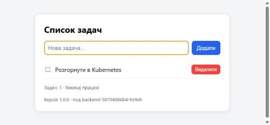
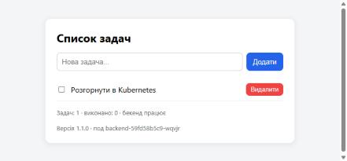

# Лабораторна робота №3 — Розгортання застосунку в Kubernetes

**Код на момент здачі:** тег [`lab3`](https://github.com/fnayed/devops-lab/tree/lab3)
**Pull Request із змінами лабораторної:** [PR «Лабораторна робота №3»](https://github.com/fnayed/devops-lab/pulls?q=is%3Apr+%D0%9B%D0%B0%D0%B1%D0%BE%D1%80%D0%B0%D1%82%D0%BE%D1%80%D0%BD%D0%B0+%E2%84%963)
**Маніфести:** [`k8s/`](../k8s)
**Збережений вивід команд:** [`docs/lab3/`](lab3)

Інструменти: **minikube v1.39.0** (драйвер docker), **kubectl v1.37.2**, Kubernetes v1.37.0, доповнення **ingress** і **metrics-server**.

## Архітектура в кластері

```
                    namespace: devops-lab
 Браузер ──► Ingress ──► Service frontend ──► Deployment frontend (2 поди, nginx)
 127.0.0.1    (nginx)                               │  /api
                                                    ▼
                         Service backend  ──► Deployment backend (2 поди, FastAPI)
                                                    │
                                                    ▼
                         Service postgres ──► Deployment postgres (1 под) ──► PVC postgres-data (1Gi)

 ConfigMap app-config ─► APP_ENV, LOG_LEVEL, POSTGRES_DB, POSTGRES_USER
 Secret    app-secret ─► POSTGRES_PASSWORD, DATABASE_URL
```

## 1. Образи застосунку

- Образи з лабораторних №1–2, публікуються CI у **GitHub Container Registry**.
- Тег `latest` не використовується — лише версії:

| Версія | Git-тег  | Що змінилося | Образи |
|--------|----------|--------------|--------|
| 1.0.0  | `v1.0.0` | базова версія: `/api/info` (версія, середовище, под) | `ghcr.io/fnayed/devops-lab-backend:1.0.0`, `…-frontend:1.0.0` |
| 1.1.0  | `v1.1.0` | на сторінці — лічильник виконаних задач | `ghcr.io/fnayed/devops-lab-backend:1.1.0`, `…-frontend:1.1.0` |

CI при push тегу `v*` збирає образи з тегом версії (`docker/metadata-action`, `type=semver`), версія вшивається в образ через `--build-arg APP_VERSION`.

## 2. Локальний кластер

```bash
minikube start --driver=docker
kubectl get nodes
kubectl get pods -n kube-system
minikube addons enable metrics-server
minikube addons enable ingress
```

Вивід: [`docs/lab3/01-cluster.txt`](lab3/01-cluster.txt) — вузол `Ready`, системні поди `Running`, доповнення увімкнені.

## 3. Namespace

`devops-lab` (за іменем проєкту) — [`k8s/00-namespace.yaml`](../k8s/00-namespace.yaml). Усі інші об'єкти мають `metadata.namespace: devops-lab`.

## 4. Маніфести (по одному файлу на об'єкт)

| Файл | Об'єкт | Ключові моменти |
|------|--------|-----------------|
| `00-namespace.yaml` | Namespace | |
| `01-configmap.yaml` | ConfigMap `app-config` | 4 параметри, підключені як змінні оточення |
| `02-secret.yaml` | Secret `app-secret` | пароль БД і рядок підключення (навчальні значення) |
| `10-postgres-pvc.yaml` | PersistentVolumeClaim | 1Gi, дані БД переживають перезапуск пода |
| `11-postgres-deployment.yaml` | Deployment postgres | 1 репліка, `strategy: Recreate`, проби `pg_isready` |
| `12-postgres-service.yaml` | Service (ClusterIP) | |
| `20-backend-deployment.yaml` | Deployment backend | 2 репліки, requests/limits, liveness/readiness `/api/health`, `maxUnavailable: 0`, `preStop` |
| `21-backend-service.yaml` | Service (ClusterIP) | |
| `30-frontend-deployment.yaml` | Deployment frontend | 2 репліки, requests/limits, проби, `maxUnavailable: 0`, `preStop` |
| `31-frontend-service.yaml` | Service (ClusterIP) | |
| `40-ingress.yaml` | Ingress | клас `nginx`, `/` → frontend |

Labels і selector узгоджені: `app.kubernetes.io/name: <сервіс>` у `selector.matchLabels`, `template.metadata.labels` та в selector Service.

**Service:** ClusterIP дає доступ усередині кластера (frontend звертається до `backend:8000`, backend — до `postgres:5432`); доступ із хоста — через Ingress.

## 5. Розгортання

```bash
kubectl apply -f k8s/
```

Вивід: [`docs/lab3/02-deploy.txt`](lab3/02-deploy.txt)

- створено всі 11 об'єктів однією командою;
- поди, Deployment, ReplicaSet, Service, Ingress, PVC — у стані Running / Bound;
- значення з ConfigMap і Secret у контейнері (`kubectl exec … env`): `APP_ENV=kubernetes`, `LOG_LEVEL=info`, `DATABASE_URL=…`, у postgres — `POSTGRES_PASSWORD`;
- `/api/info` повертає `"env":"kubernetes"` — значення з ConfigMap дійшло до застосунку.

Застосунок у браузері (http://127.0.0.1 через `minikube tunnel`):

| Версія 1.0.0 | Версія 1.1.0 |
|---|---|
|  |  |

## 6. Керування життєвим циклом

Вивід: [`docs/lab3/03-selfheal-scale.txt`](lab3/03-selfheal-scale.txt), [`04-update-rollback.txt`](lab3/04-update-rollback.txt), [`05-zero-downtime.txt`](lab3/05-zero-downtime.txt)

| Пункт | Команда | Результат |
|-------|---------|-----------|
| a) Самовідновлення | `kubectl delete pod <backend-pod>` | ReplicaSet одразу створив новий под (`ContainerCreating` → `Running`) |
| b) Масштабування | `kubectl scale deployment backend --replicas=4` | 4 поди; 20 запитів через Ingress розподілились між усіма 4 подами (6/6/6/2) |
| c) Rolling update | `kubectl set image deploy/backend backend=…:1.1.0` | поди замінювались по одному, `/api/info` → `"version":"1.1.0"` |
| d) Історія і відкат | `kubectl rollout history` / `kubectl rollout undo` | відкат до ревізії з 1.0.0, потім повернення до 1.1.0 |
| e) Доступність | `curl /api/health` кожні 0.25 с під час оновлення | **160 з 160** відповідей `200` |

> **Знахідка під час виконання.** Перший замір доступності показав 4 невдалі запити зі 120 (під час оновлення).
> Причина: старий под зупинявся раніше, ніж Ingress і Service переставали надсилати на нього трафік.
> Виправлення: у Deployment додано `lifecycle.preStop: sleep 5` — под ще кілька секунд обслуговує запити, поки його прибирають із балансування.
> Повторний замір — 160/160 успішних відповідей ([`05-zero-downtime.txt`](lab3/05-zero-downtime.txt)).

## 7. Діагностика

Вивід: [`docs/lab3/06-diagnostics.txt`](lab3/06-diagnostics.txt)

1. **Неіснуючий тег:** `kubectl set image deploy/backend backend=…:9.9.9` → под у стані `ErrImagePull`, далі `ImagePullBackOff`.
2. **Причина:** `kubectl describe pod` і `kubectl get events` — `Failed to pull image "…:9.9.9": … not found`.
   Застосунок при цьому продовжував працювати: завдяки `maxUnavailable: 0` старі поди не прибираються, доки нові не стануть готовими.
3. **Логи і вхід у контейнер:** `kubectl logs <pod>`, `kubectl exec -it <pod> -- sh` (перевірено `hostname`, змінні оточення, `/api/health` зсередини).
4. **Виправлення:** повернуто тег `1.1.0` → `rollout status` успішний, усі поди `Running`.

## Команди для демонстрації

```bash
minikube start
minikube tunnel                     # окреме вікно, від адміністратора; сайт — http://127.0.0.1
kubectl apply -f k8s/
kubectl -n devops-lab get pods,deploy,rs,svc,ingress,pvc
kubectl -n devops-lab exec deploy/backend -- env | grep -E 'APP_ENV|LOG_LEVEL|DATABASE_URL'

kubectl -n devops-lab delete pod <backend-pod>                      # самовідновлення
kubectl -n devops-lab scale deployment backend --replicas=4         # масштабування
kubectl -n devops-lab set image deploy/backend backend=ghcr.io/fnayed/devops-lab-backend:1.1.0
kubectl -n devops-lab rollout status deploy/backend
kubectl -n devops-lab rollout history deploy/backend
kubectl -n devops-lab rollout undo deploy/backend                   # відкат

kubectl -n devops-lab set image deploy/backend backend=ghcr.io/fnayed/devops-lab-backend:9.9.9   # помилка
kubectl -n devops-lab describe pod <pod>
kubectl -n devops-lab get events --sort-by=.lastTimestamp
kubectl -n devops-lab logs <pod>
kubectl -n devops-lab exec -it <pod> -- sh
```
